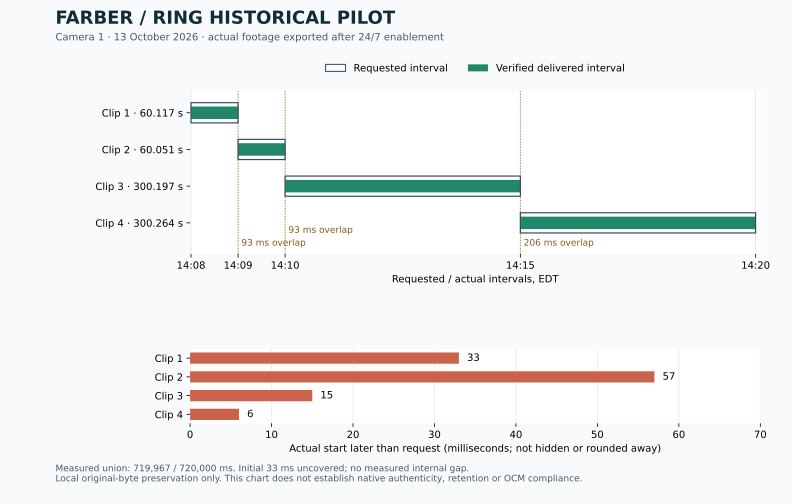

# Farber Security Command Center: Ring pilot findings

East End Flower Farm Ltd. · 2026-10-13 · Phase 1

**Quiet historical retrieval, planned-overlap target coverage, token refresh and local worker crash recovery: PASS for the tested samples. Full source qualification: NOT PASSED.** After the owner upgraded the plan and confirmed 24/7 enabled, the official Ring API returned eight event-free historical exports. No live view was initiated. All eight MP4s decode and their actual intervals overlap at every internal boundary across nearly 24 minutes. The first returned frame begins 33 ms after the earliest requested start; that remains a visible coverage discrepancy. The separately planned overlap target has complete measured coverage. This demonstrates quiet-period exports on this camera/account, not complete 60/90-day retention, camera-native evidence authenticity or OCM compliance.

Final evidence register: [`2026-10-13-pilot-final.json`](../../pilot/results/2026-10-13-pilot-final.json). Eight preserved files total **270,672,986 bytes**; all eight were independently rehashed after recovery. Their post-test union covers **1,438,967 / 1,439,000 ms** from 18:08:00–18:31:59 UTC, with only the initial 33 ms uncredited. This aggregate review is distinct from each predeclared test target. It does not silently change an earlier request or erase its discrepancy.

## Actual historical results after the upgrade

Camera “1”, owner-reported Indoor Cam 2K. October 13, 2026; times below are UTC (subtract four hours for EDT). Full official event-history pagination returned no overlapping events in either test window. Media, not that metadata, establishes the measured coverage.

| Requested interval | Actual start | Decoded duration | Frames | Original response bytes |
|---|---|---:|---:|---:|
| 18:08:00–18:09:00 | 18:08:00.033 | 60.117 s | 901 | 11,309,551 |
| 18:09:00–18:10:00 | 18:09:00.057 | 60.051 s | 900 | 11,269,492 |
| 18:10:00–18:15:00 | 18:10:00.015 | 300.197 s | 4,498 | 57,010,544 |
| 18:15:00–18:20:00 | 18:15:00.006 | 300.264 s | 4,500 | 56,480,912 |

All final responses were HTTP 200 after HTTP 303 redirects, H.264 at 2560×1440 and approximately 15 fps. Measured timing uses each response's `X-Media-Timestamp` plus the actual file duration; `X-Media-Length` was absent. Frame timelines passed the pilot's gap checks and all frames decoded. Adjacent file intervals overlap by **93, 93 and 206 ms**; the union covers **719,967 / 720,000 ms** of the requested window. No internal missing interval was measured. The runner labels each individual shifted request partial even though Ring returned HTTP 200; that label must not be confused with an observed HTTP 206. No HTTP 206, rate limit or vendor 5xx was observed in these four completed downloads.

The files total **136,070,499 bytes**. SHA-256, byte counts, fsync and independent local readback succeeded. Originals remain private, unchanged and separate from extracted review frames. This is local pilot preservation, not an uploaded, commissioned independent archive. Machine-readable requests, actual intervals, hashes and boundary measurements are in `pilot/results/2026-10-13-twelve-minute-pilot.json`.

Visual review of the first minute's start/end and the adjacent clip's start found the same grow-room scene with plausible changing fan orientation. Samples appear monochrome with a bright foreground; face identification and required color/low-light coverage have not been commissioned. Ring's visible `Generated-At` overlay stayed at the download-generation time (18:25:02Z or 18:27:22Z), not the historical capture time. It does not prove a synchronized embedded capture clock. Native authenticated evidence format, independent clock alignment and full-boundary visual analysis remain unresolved.

Official OAuth refresh succeeded between the two one-minute exports. A new local worker process reopened the same SQLite queue, reconciled the first original and completed the second queued request using persisted credentials. The actual crash test below separately demonstrates interrupted-transfer recovery.

### Planned overlap: exact sample coverage passed

A separate run requested **18:22:00–18:27:00** and **18:26:59–18:31:59 UTC**, with a one-second lookback planned before execution. Its declared target was **18:22:01–18:31:59 UTC**. Returned starts were 18:22:00.046 and 18:26:59.035, with decoded durations 300.192 and 300.197 seconds. Both 2560×1440 H.264 files decoded and passed frame-timeline checks. Their actual intervals overlap by **1,203 ms**, covering **598,000 / 598,000 ms of the declared target with zero measured gaps**. Complete official history again showed no overlapping events, including the lookback margin.

This demonstrates complete coverage of that tested target through the official API with planned overlap. It does not alter the earlier requests, hide their start offsets or establish every future interval. Each individual response remains marked shifted/partial in the job ledger. The combined target is independently marked `MEASURED_CONTIGUOUS`; production approval remains false. Evidence: `pilot/results/2026-10-13-overlap-pilot.json`.

### Actual interrupted-transfer recovery: passed

The export worker was killed with SIGKILL at **18:35:16.279 UTC**, after **86,002 bytes** reached its partial file. Its SQLite job and normal ten-minute lease survived. The lease expired at **18:45:07.517 UTC**; a new worker process started at **18:46:07.361 UTC** and finished at **18:46:28.155 UTC**. No lease timestamp was edited or accelerated. The same stored request and job key were reused on attempt two. The next queued request also completed. The incomplete file remains separately preserved and receives no coverage credit.

| Requested interval | Actual start | Decoded duration | Frames | Bytes |
|---|---|---:|---:|---:|
| 18:20:00–18:21:00 | 18:20:00.062 | 60.054 s | 900 | 11,186,501 |
| 18:21:00–18:22:00 | 18:21:00.020 | 60.119 s | 901 | 11,139,531 |

Both returned HTTP 200 after 303, decoded at 2560×1440/15 fps, passed frame-timeline checks and matched their SHA-256 on readback. The recovered pair overlaps by 96 ms; its own initial 62 ms discrepancy remains in that run's report. Earlier measured footage covers that boundary in the post-test aggregate. Complete official event history again contained no overlapping events. Evidence: [`2026-10-13-crash-recovery.json`](../../pilot/results/2026-10-13-crash-recovery.json).

This demonstrates recovery of the **local export worker**, not a Vercel cold restart, an operating-system/disk failure, a deployed unattended service or five-minute notification delivery. All eight completed downloads returned HTTP 200; live HTTP 206, 429 and vendor 5xx recovery remain unobserved and are tested with fixtures only.

## Actual observations

| Check | Actual result | Evidence / limitation |
|---|---|---|
| Existing implementation | Inspected | `mrbrickandstone/GROWLINK`, base commit `ae3aecb8c441964760ca5facf971165e8aa698ad` |
| Production deployment | READY when inspected | `dpl_4DaYwKEpAvG6rG6vqbugBGsXL4KH`, Vercel project `farber-growlink-dashboard` |
| Isolation | Branch and temporary pilot runtime | Local clone in `growlink/`, branch `codex/farber-security-pilot`; remote branch created through the GitHub connector after native Git push returned 403. Main production URL stayed on its original deployment. Secondary team URL was unexpectedly reassigned by Vercel during staging and restored; see deployment note below |
| Design briefs | REVIEWED | Both supplied PDFs read in full (architecture 8 pages; feasibility 10 pages), with relevant rendered diagrams/tables inspected. See `BRIEF_RECONCILIATION.md` and the source hash register |
| Ring integration | Official API confirmed in source | OAuth one-way linking, HMAC verification, AES-256-GCM encrypted Redis token storage, serialized refresh; WHEP live view only |
| Credentials | Runtime access works | User completed Vercel login. Ring and Redis values are sensitive secrets and cannot be exported by env pull. A signed, expiring endpoint uses them only inside Vercel |
| Camera count/permissions | OBSERVED | Three authorized cameras named “1”, “3”, “2”; OAuth scope `ava.v1:read`; account linked 2026-10-11 11:19:58.812 UTC. Historical download access demonstrated by the actual exports below |
| Camera “1” model | OWNER-REPORTED; ELIGIBILITY VERIFIED | User identified it as **Indoor Cam 2K**. Ring's current eligible-device list explicitly includes this model. This does not verify the installed subscription, recording setting or continuous power; no model was inferred from the API or image URL |
| API capabilities | OBSERVED | All three report AVC, 16:9, maximum/supported resolution 1440. API does not supply a model/SKU; these capabilities are not proof of actual returned footage quality |
| Camera “1” configuration | OBSERVED | Motion detection “on”, E2EE false, IR LED night vision “off”; no 24/7 setting or recording subscription is exposed in this response. Night image quality remains untested |
| 24-hour recording setting | OWNER REPORTS ENABLED | Earlier motion-only observation is preserved in its checkpoint. After upgrading, owner confirmed 24/7 “JUST NOW”; all tested windows follow the conservative 18:08 UTC cutoff |
| Subscription | OWNER REPORTS UPGRADED | Exact plan/add-on SKU remains unknown. The agent made no purchase or setting change |
| Continuous power / mode pauses | OWNER RESPONSE ONLY | The owner answered yes to a combined question covering continuous power and no mode/schedule pauses. Independent verification and power commissioning remain outstanding |
| Quiet-period selection | METADATA EXCLUSION CHECK PASSED | Four runs spanning October 13 18:08–18:31:59 UTC: each followed complete history across 30 pages, with no overlapping events, including the lookback margin. Earlier October 12 candidate was discarded after the owner disclosed motion-only recording |
| Consecutive quiet-period exports | DEMONSTRATED ON EIGHT SAMPLES | Four one-minute and four five-minute requests returned usable historical MP4s; all actual intervals and discrepancies retained |
| Duration, timestamps, boundaries, gaps, picture quality | MEASURED / LIMITED VISUAL REVIEW | Actual results above; embedded capture clock, native authenticity and identification coverage unresolved |
| Partial responses and retries | TIMING DISCREPANCIES OBSERVED; HTTP 206 NOT OBSERVED | Host-review retry used identical timestamps and preserved its attempt history. Rate-limit/transient policies remain mock-tested only |
| OAuth rotation | LIVE PASS | Explicit refresh succeeded; a separate local process then queried the remote runtime and received all three cameras using persisted credentials |
| Export-worker restart recovery | CLEAN RESTART AND REAL CRASH RECOVERY PASS | Actual SIGKILL during transfer, normal lease expiry, a fresh process and same-job completion demonstrated. Partial bytes remain separate; no cloud cold-restart claim |
| Media tools | Installed and tested | FFmpeg / ffprobe 8.1.2; synthetic 2-second, 50-frame, 320×240 video decoded and measured correctly; corrupt file rejected |

Machine-readable checkpoints are in `pilot/results/`: cloud inspection supersedes pre-login blockers, owner-model records model provenance, and owner-configuration records the later motion-only/add-on observation. The design-brief register records the supplied file hashes. These checkpoints contain observations and evidence hashes, not credentials. Raw responses and downloaded originals are private in `.pilot/` and excluded from Git; the historical sample checkpoints record hashes without media or credentials.

### Temporary deployment and production preservation

The metadata-only runtime is deployment `dpl_48knSyGbzsdjmWHEbr2HVHFjJ2eu`. It uses production secret injection because the existing sensitive secrets cannot be exported. Only reviewed Ring metadata/refresh operations are exposed: requests require a local Ed25519 signature, 60-second freshness, a deployment-specific audience and an unused Redis nonce. The endpoint rejects requests after **2026-10-13 21:25:11.956 UTC (17:25 EDT)**. No private signing key was uploaded. It cannot start live view, download footage or change camera settings.

Although CLI `--prod --skip-domain` was used, Vercel reassigned `farber-growlink-dashboard-marcos-projects-83f88565.vercel.app` to the pilot. It was promptly restored and verified against the original deployment. The primary `farber-growlink-dashboard.vercel.app` was verified unchanged throughout. Future staging must verify every alias; this CLI behavior means `--skip-domain` alone is insufficient assurance for the team alias. No production code was promoted or camera setting altered. Refresh testing intentionally updates the existing encrypted OAuth record under its distributed lock.

The owner explicitly approved a separate signed media preview after automatic review initially blocked temporary credential access. The final preview is `dpl_G3S1i1te4X8DkQh3UmYornb1d5ZM`, bound to camera “1”, post-enablement historical times and requests of at most five minutes. It expires **2026-10-13 22:11:48.259 UTC (18:11 EDT)**. Branch-scoped credential access was used only for the build, then restored to production-only; all three production aliases were verified unchanged. Earlier preview setup errors occurred before Ring media requests and are not camera failures. Details and non-secret checks are in `2026-10-13-media-preview-corrected.json` and `RUNBOOK.md`.

**Pilot access closed at 18:54 UTC:** after evidence preservation, all three temporary deployments were removed by exact ID with Vercel's safe alias guard. They now return 404 from the deployment API, before their configured expiry. All three production aliases were independently rechecked against the original production deployment, and all three Ring variables remain production-only. No pilot runtime remains active. See [`2026-10-13-pilot-cleanup.json`](../../pilot/results/2026-10-13-pilot-cleanup.json). A future authorized test needs a new bounded runtime; the URLs above are historical evidence references.

## What the official sources establish

Ring documents an official historical MP4 endpoint with timestamp and duration inputs, actual-media headers, partial responses, and token refresh. It explicitly retrieves already-recorded media. Its examples emphasize event/live recordings; the documentation reviewed does not explicitly guarantee access to the complete 24/7 idle-period timeline. The pilot deliberately excludes live-session creation. [Ring Partner API](https://developer.amazon.com/docs/ring/api-documentation.html)

Ring's consumer documentation lists **Indoor Cam 2K** as eligible when continuously powered, with Ring Protect and the required per-camera 24/7 Recording add-on. The owner must select 24/7 Recording in Device Settings → Video Settings → Recording Mode; Home/Away/Disarmed preferences can pause it. Ring describes up to 14 days of continuous cloud history and manual downloads of up to ten minutes; event storage is different. Model eligibility does not establish that camera “1” was recording continuously during the candidate period or that automated API exports are complete. [Ring 24/7 recording](https://ring.com/support/articles/wtr7r/24-7-recording-security-cams)

Ring's terms permit internal lawful business use under stated conditions. The developer policy requires disclosure of retention, deletion, sharing, consent withdrawal and workplace monitoring practices, and imposes per-instance consent restrictions for law-enforcement access. Whether those rules cover OCM inspectors in this use case needs written clarification; a successful API call would not settle it. [Ring terms](https://ring.com/terms), [developer content policy](https://developer.amazon.com/docs/ring/content-policy.html)

The briefs prompted further review of program restrictions on service monitoring, consequential-risk use and deletion requests, plus mandatory API watermarking and encryption behavior. These are unresolved acceptance issues, recorded with current official sources and unsent vendor questions in `BRIEF_RECONCILIATION.md`. Do not apply irreversible locks to Ring-derived data or promise inspector access before those issues are resolved.

OCM's current regulations index links adopted adult-use regulations effective November 5, 2025. Section 125.3 calls for commercial-grade security, continuous video during operation/handling, at least 60 days' recordings, synchronized embedded timestamps, authenticated proprietary and standard-format export capability, unaltered copies and investigation preservation, requested immediate viewing, failure alerts within five minutes, eight hours of backup operation, inspections within 30 days and five-year security-test records. Confirm applicability to this license, premises and approved security plan before acceptance. [OCM current index](https://cannabis.ny.gov/marihuana-regulation-and-taxation-act-mrta-public-comment-process), [adopted regulations, §125.3](https://cannabis.ny.gov/adopted-au-regulations)

## Recording-source recommendation

Continue the Ring-to-independent-archive design as the preferred candidate: the official API has now returned quiet 24/7 footage, and a planned-overlap run covered its entire declared target. There is no basis to replace the installed cameras merely on an assumption that idle-period exports are unavailable. Ring remains unqualified as the sole required evidence source until capture-time synchronization, native authentication, operating reliability and vendor-policy gates are resolved.

If the remaining qualification gates pass, use a separately hosted durable worker and independently verified archive with the approved retention/hold policy; Ring cloud retention alone does not meet the requested archive period. If the pilot fails or vendor terms cannot support the required evidence workflow, use a commercial local recorder as the primary source, retaining Ring where useful. A recorder candidate and the access needed are documented in `ARCHITECTURE.md`. Nothing was purchased.

## Implemented and tested

- Worker-only historical operations reuse existing encryption, Redis locking and OAuth refresh. They are not reachable through the public Ring API handler.
- Pilot plan requires configuration evidence; account-consent dates and authorized camera/component selection are checked before export.
- Paginated history rejects windows with events. Empty history is never counted as footage.
- Stable request IDs and SQLite leases persist jobs across process exits. Retries preserve timestamps and respect Retry-After. Older 416 responses stop as unavailable.
- Downloaded bytes are preserved as separate content-addressed versions; streaming SHA-256, byte count, fsync and readback checks precede measurement. Reconciliation removes coverage credit for missing or altered local files.
- Frame timing, full decode, actual start, measured duration and interval unions expose missing intervals. A 200 response without trustworthy timing is insufficient.
- Common camera, recorder, archive receipt and inspector-grant contracts are aligned with the supplied architecture. They include six source operations, explicit unsupported/unverified results, site/module scope, native versus vendor-delivered media, requested versus actual bounds, pending holds, viewer revocation behavior and owner/operator/technician/inspector/auditor roles. They are interfaces, not commissioned adapters, authorization enforcement or a finished archive.

`npm test`: **39 passed, zero failures, zero skipped** at this checkpoint (16 existing tests plus 23 security tests). Tests include signature forgery, expiry, stale/wrong-audience requests, replay across handler instances and rejection of live/download operations by the metadata bridge. They use mock network responses and synthetic/local media and do not prove real camera performance. `git diff --check` passed. Live API observations above are recorded separately.

The runner cannot automatically grant production approval. Human review must still assess embedded time, clock alignment, legibility, day/night quality, adjacent-boundary content, and the vendor evidence format. A local hash establishes integrity since receipt, not native camera authenticity.

The updated TypeScript contracts pass strict no-emit compilation. The brief expands acceptance to a seven-day engineering pilot with several consecutive quiet hours, overlap checks, failure/power/coverage drills and actual day-61/day-91 retention checks. None of those results can be inferred from the current unit tests or metadata observations.

## Concrete blockers and unfinished work

1. Eight quiet samples across nearly 24 minutes demonstrate historical retrieval; planned overlap passes exact sample coverage and a real crash recovers correctly. Complete multi-hour/day/night testing, capture-clock/native-evidence verification, and independent power/mode commissioning before source acceptance. Earlier motion-only footage cannot answer the continuous test.
2. Both briefs are received and reconciled. Remaining site inputs include actual room/location coverage, licensed areas, approved security plan, measured bandwidth/bitrate, power inventory and independent alert recipients.
3. The signed, bounded media preview and durable local runner completed the approved pilot. All temporary deployments were then retired; production-only credential scopes and all production aliases are restored and verified. Independent storage/upload verification, native recorder access, alert channels and named identity-provider configuration are still unprovisioned.
4. Resolve Ring's permission for unattended bulk 24/7 exports, retention/holds after consent withdrawal, inspector access, limits and camera-origin authentication. No vendor messages have been sent.
5. Once the source is validated, implement and commission the dashboard, independent archive/storage, named identity provider, holds/deletion workflows, monitoring delivery, inspector access and site records. If continuing with a commercial recorder, obtain supported recorder/API access and native sample exports first. Those production features are not complete in this phase and the system is not labeled OCM-compliant.
